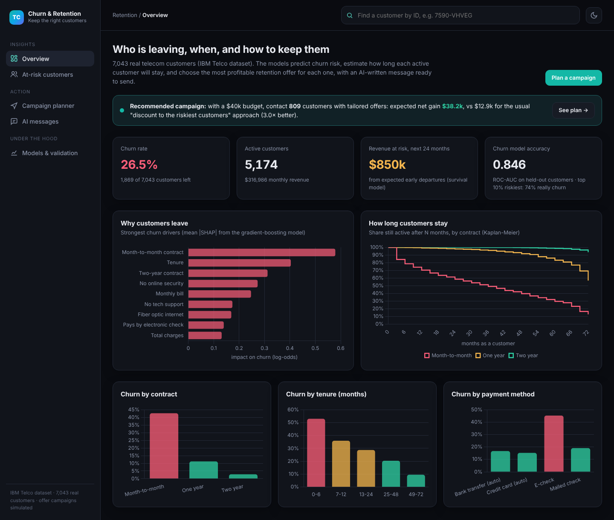
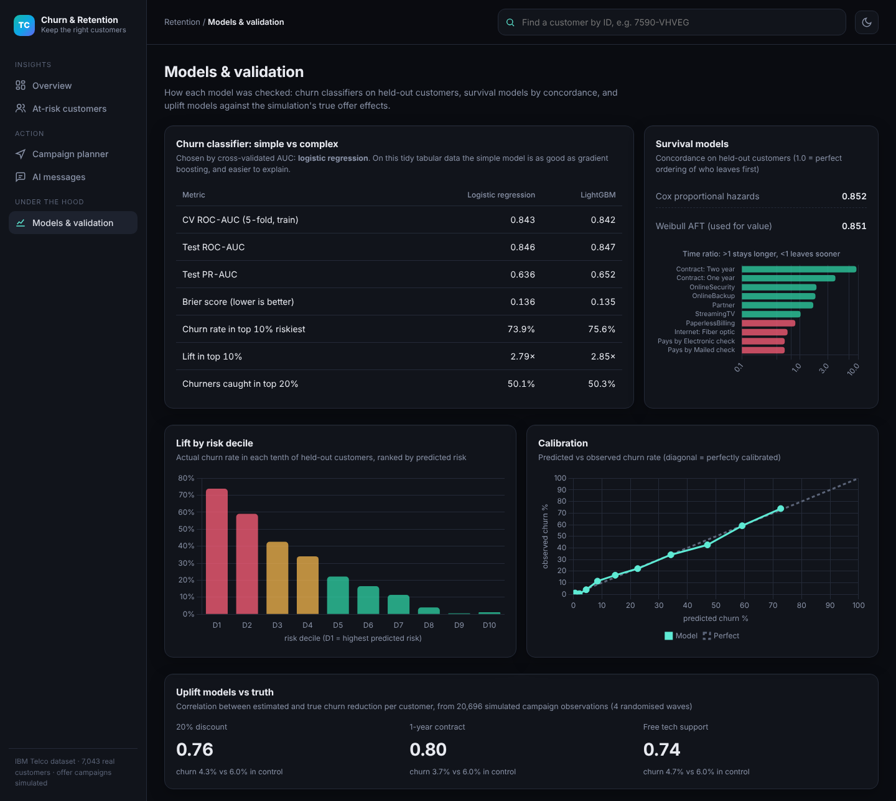
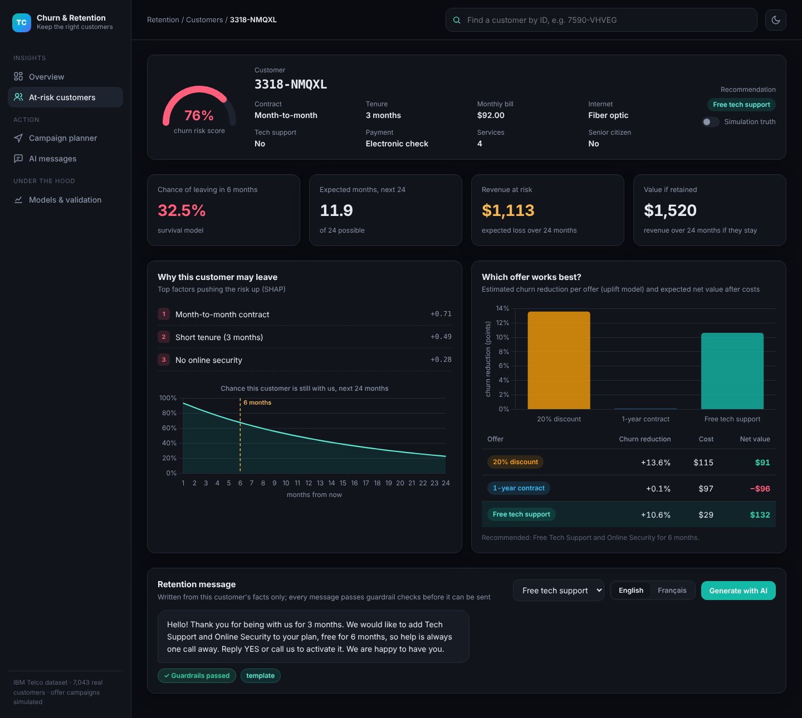
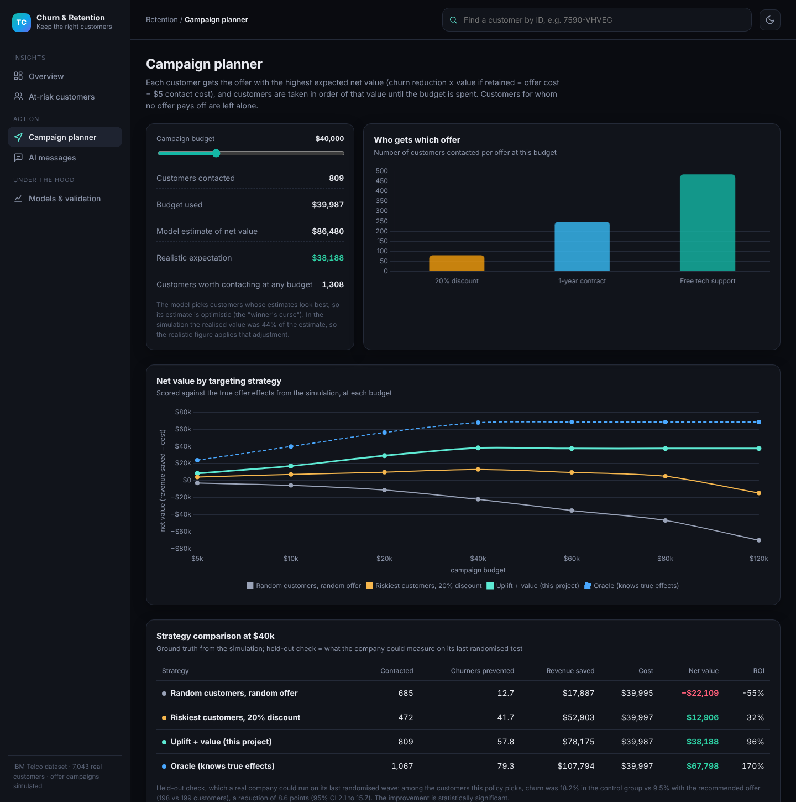
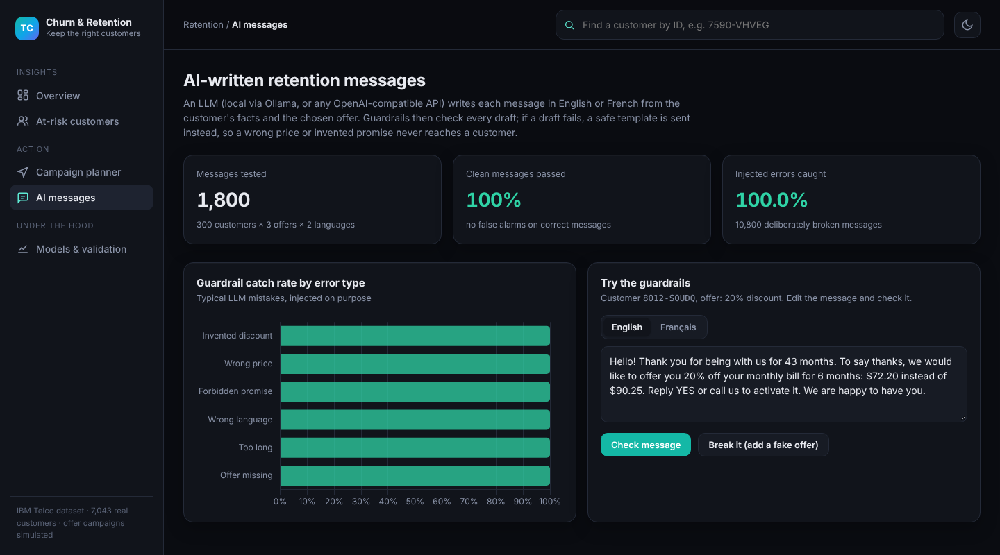
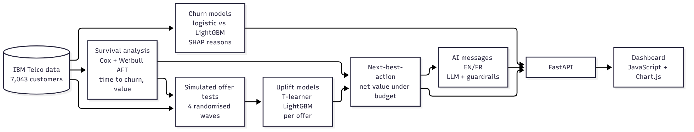

# Telecom Churn & Retention

**Who is about to leave, when, which offer would keep them, and the message to send them.**

[](https://github.com/Abakar-Fatime/telecom-churn-retention/actions/workflows/ci.yml)
 



Most churn projects stop at "this customer has a 76% churn risk". A retention team needs more: **when** the customer is likely to leave, **how much they are worth**, **which offer** would actually change their mind (some offers make no difference, and some loyal customers churn *more* when contacted), whether the campaign **pays for itself**, and a **message** ready to send. This project builds that full decision chain on 7,043 real telecom customers.

| Step | Method | Result |
| --- | --- | --- |
| **1. Who will leave** | Logistic regression vs LightGBM, SHAP reasons per customer | Test ROC-AUC **0.846**; 74% of the top 10% riskiest customers really churn (2.8× lift) |
| **2. When** | Survival analysis: Cox and Weibull AFT models | Concordance **0.85**; two-year contracts stay **9.3×** longer than month-to-month |
| **3. What they're worth** | Expected months retained over 24 months × monthly bill | **$850k** of revenue at risk over 24 months |
| **4. Which offer** | Simulated randomised offer tests + T-learner uplift models (LightGBM) | Uplift targeting nets **$38.2k** on a $40k budget, **3.0×** the common "discount to the riskiest" approach |
| **5. The message** | LLM (Ollama or OpenAI-compatible) in English and French + guardrails | Guardrails caught **100%** of 10,800 injected errors with no false alarms |

## Data

**[IBM Telco Customer Churn](https://github.com/IBM/telco-customer-churn-on-icp4d)**: 7,043 real customers with tenure, contract, services, billing, payment method and whether they left (26.5% churned). Eleven brand-new customers with a blank total-charges field are set to 0, since they had not been billed yet.

**What is simulated, and why.** The dataset has no history of retention offers, and no public telecom dataset does. To learn *which offer works for whom*, the project simulates what a real operator would run: **four quarterly randomised tests** on the 5,174 active customers (control, 20% discount, 1-year contract, free tech support; 25% each, 20,696 observations). Offer effects depend on each customer's real profile, for example discounts work for price-sensitive month-to-month customers on high bills, and free tech support works for fiber customers without it. The simulation also includes **"sleeping dogs"**: 1,241 loyal long-contract customers who churn *more* when contacted. Because the true effects are known, every targeting strategy can be scored exactly.

## 1. Who will leave: churn models

| Metric (held-out 25%) | Logistic regression | LightGBM |
| --- | --- | --- |
| CV ROC-AUC (5-fold) | **0.843** | 0.842 |
| Test ROC-AUC | 0.846 | 0.847 |
| Test PR-AUC | 0.636 | 0.652 |
| Churn rate in top 10% riskiest | 73.9% | 75.6% |
| Churners caught in top 20% | 50.1% | 50.3% |

**The simple model ties the complex one.** On this clean tabular data, logistic regression is as accurate as gradient boosting, and it was chosen by cross-validated AUC. SHAP values from the boosting model give each customer readable reasons, such as *"Month-to-month contract · Short tenure (3 months) · No online security"*. The strongest drivers overall are month-to-month contracts, short tenure, no online security and high monthly bills.



## 2–3. When they will leave, and what they're worth

Treating "still a customer" as censored data, survival models estimate how long each customer will stay. Duration-derived columns such as total charges are excluded to avoid leakage.
- **Concordance:** Cox 0.852, Weibull AFT 0.851 on held-out customers. The Weibull model is used because it extrapolates smoothly beyond the observed 72 months.
- **For each active customer:** the chance of leaving in the next 6 months, expected months retained over the next 24, revenue at risk, and value if retained.
- **Time ratios:** a two-year contract multiplies expected lifetime by 9.3 and a one-year contract by 4.1. Electronic-check payment cuts it by about half.



## 4. Which offer: next-best-action under a budget

For every customer and offer, the T-learner estimates the reduction in churn probability. The **expected net value** of an action is:

> churn reduction × value if retained − offer cost − $5 contact cost

Customers are taken in order of that value until the budget runs out. Customers for whom no offer pays off, including the sleeping dogs, are **not contacted**.

**Model selection without peeking at the truth.** The uplift models' regularisation is chosen by log-loss on the held-out fourth wave, which a real team could do. With strong regularisation, estimated uplift correlates **0.74–0.80** with the true effects.

**Results at a $40,000 budget** (scored against the true simulated effects):

| Strategy | Contacted | Churners prevented | Revenue saved | Net value | ROI |
| --- | --- | --- | --- | --- | --- |
| Random customers, random offer | 685 | 12.7 | $17,887 | **−$22,109** | −55% |
| Riskiest customers, 20% discount (common practice) | 472 | 41.7 | $52,903 | $12,906 | 32% |
| **Uplift + value (this project)** | 809 | **57.8** | **$78,175** | **$38,188** | **95%** |
| Oracle (knows true effects) | 1,067 | 79.3 | $107,794 | $67,798 | 170% |

The engine chooses a mix: 483 tech-support offers, 246 contract upgrades and only 80 discounts. Discounts are expensive and only pay off for price-sensitive customers. Two more findings:
- **Spending more stops helping.** Above about $40k, the uplift strategy stops spending because no remaining customer is worth contacting. The discount strategy keeps spending and turns negative at $120k.
- **The held-out check is significant.** On the last randomised wave, among the customers the policy picks, churn was 18.2% in control vs **9.5%** with the recommended offer. That's a reduction of 8.6 points, 95% CI 2.1 to 15.7, which is statistically significant.
- **The winner's curse is measured and shown.** Customers are chosen *because* their estimates look best, so the model's own estimate ($86.5k) is optimistic: the realised value is 44% of it. The planner shows both figures.



## 5. AI-written messages with guardrails

For each targeted customer, an LLM writes a short retention message in **English or French** from the customer's facts and the chosen offer: local and free via [Ollama](https://ollama.com), or any OpenAI-compatible API. Every draft passes through a validator before it can be sent. The validator rejects drafts that:
- mention a percentage or price that isn't in the customer's facts
- make a forbidden promise ("guaranteed", "forever", …)
- miss the offer
- run over 90 words
- are written in the wrong language

Rejected drafts are replaced by a safe template, so a wrong price never reaches a customer.

**Evaluation:** 1,800 correct messages (300 customers × 3 offers × 2 languages) all passed, and **10,800 deliberately broken messages** (invented discount, wrong price, forbidden promise, wrong language, too long, offer missing) were all caught. One real bug was found and fixed along the way: an invented "50% off" slipped through for a customer with 50 months of tenure, because the number 50 was allowed. Percentages are now checked separately from other numbers, and a test covers the case.



## Architecture



## Quick start

```bash
git clone https://github.com/Abakar-Fatime/telecom-churn-retention.git
cd telecom-churn-retention
pip install -r requirements.txt

python -m churnlab.pipeline            # train, simulate, evaluate (~10 seconds)
uvicorn churnlab.api:app --port 8000   # dashboard at http://localhost:8000
pytest -q                              # 16 tests
```

To have an LLM write the messages (otherwise the safe templates are used):

```bash
ollama pull qwen2.5:3b-instruct                      # free, local
CHURN_LLM_BACKEND=ollama uvicorn churnlab.api:app

CHURN_LLM_BACKEND=openai OPENAI_API_KEY=... CHURN_LLM_MODEL=gpt-4o-mini uvicorn churnlab.api:app
```

## Project structure

```
churnlab/
  data.py        load and clean the IBM Telco data, feature engineering
  model.py       logistic regression vs LightGBM, lift, calibration, SHAP reasons
  survival.py    Cox and Weibull AFT models, 6-month churn chance, expected months, value
  retention.py   simulated offer tests, T-learner uplift, budget policy, strategy comparison
  messages.py    LLM backends, EN/FR templates, guardrail validator, error injection
  pipeline.py    runs everything, writes results/*.json
  api.py         FastAPI backend
web/             dashboard (index.html, app.js, styles.css)
results/         every output the dashboard shows
tests/           16 tests: data, models, retention, guardrails, API
```

## Limitations
- The churn and survival models use real data. Offer effects come from a simulation, because no public telecom dataset records retention offers. The method is what transfers to a real operator: randomised tests, uplift models, budgeted targeting and guardrails.
- The IBM dataset is a single snapshot, so "time" comes from tenure, not from repeated observations of the same customer.
- Message quality with a live LLM depends on the model chosen. The guardrails guarantee that what is sent is factually safe, not that it is well written.

---
Built by **Abakar Sougui Fatime**: [GitHub](https://github.com/Abakar-Fatime) · [LinkedIn](https://linkedin.com/in/abakar-sougui-fatime)
